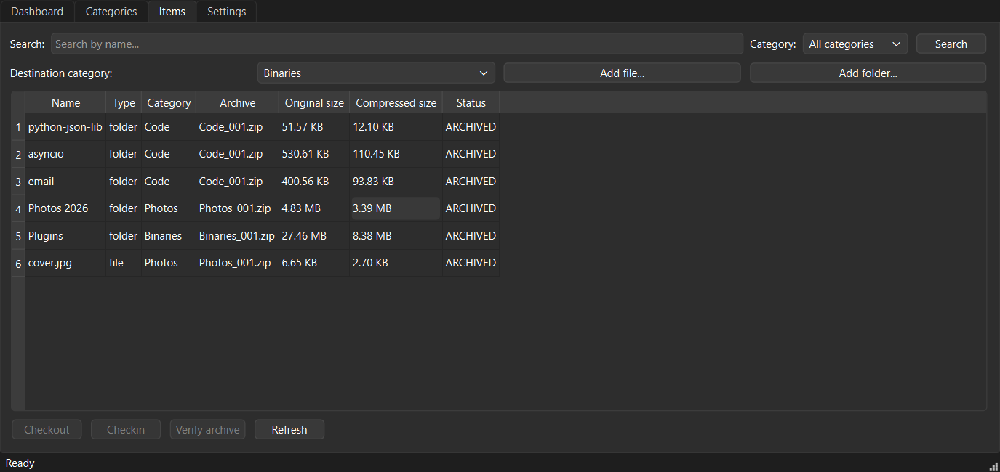

# StorageArch

A Windows desktop archiver that chooses the best lossless compression for each file by what the file
contains, and stores nothing it has not restored and verified byte for byte.

## How it works

1. **Read once.** Each file is read a single time: its real type is taken from its bytes (not its name),
   its SHA-256 is computed, and the size of a plain ZIP (Deflate) member is measured - the baseline.
2. **Try what fits.** The compression methods are chosen smartly for each file, by what it contains; a file
   that is already compressed gets only a cheap check. Every candidate is compressed **and restored**, and
   the restored bytes must match the original SHA-256.
3. **Keep it only if it pays.** A verified candidate wins only if it beats the ZIP baseline by at least
   3 % or 1 MiB; otherwise the file is stored as a normal ZIP member.

Archives are standard ZIP files with a manifest next to them. Items can be checked out to a workspace,
edited and checked in (a folder writes only the files that changed), and every archive can be verified
at any time.

## Results

Space saved on three folders of real files, against ZIP, RAR and 7z at their normal setting (same machine).
After archiving, StorageArch restored every file and each one matched the original byte for byte.

| | Real files, 1.7 GB (2,329 files) | Files only, 1 GB (6,348 files) | Mixed, half photos, 1 GB (4,758 files) |
|---|---:|---:|---:|
| ZIP (7-Zip) | 72.0 % - 17 s | 70.0 % - 22 s | 44.1 % - 30 s |
| RAR (WinRAR) | - | 73.3 % - 97 s | 46.0 % - 84 s |
| **StorageArch** | **76.7 % - 85 s** | **73.9 % - 258 s** | **54.3 % - 369 s** |
| 7z (7-Zip) | 79.0 % - 98 s | 78.2 % - 237 s | 49.8 % - 262 s |

StorageArch beats ZIP and RAR everywhere and is the smallest of all when photos are involved (JPEG and BMP are
stored losslessly as JPEG XL). 7z is smaller on plain files because it packs everything into one solid block -
a single file cannot be taken out quickly, and the result is not a standard ZIP. The price is time: every
candidate is restored and checked before it is kept.

## The optional cloud part

The app works fully offline. The cloud client is optional and off by default: it lets the compression rules be
improved from anonymous usage statistics (which method won for each file type, and by how much). File names,
paths and file contents are never sent.

## Download

The ready-to-run Windows app, `StorageArch.exe`, is on the [Releases](https://github.com/LoayAmer910/storagearch/releases/latest)
page - no Python needed. The file is not code-signed, so Windows SmartScreen may warn on first run: choose
**More info**, then **Run anyway**. The app keeps its data in a `SmartArchiveData` folder next to where it is
started, so put the EXE in a folder of its own.

## Requirements

- Windows, Python 3.14+
- `pip install -r requirements.txt` (development and tests: `requirements-dev.txt`)
- Optional: the JPEG XL tools `cjxl.exe` / `djxl.exe` (from [libjxl](https://github.com/libjxl/libjxl/releases))
  in a `tools` folder next to the code, or in the folder named by `STORAGEARCH_JXL_TOOLS_DIR`. Without
  them, JPEG and BMP files use the general compressors.

## Run

    python app.py

## Build the Windows app (EXE)

    pip install pyinstaller
    python -m PyInstaller StorageArch.spec --noconfirm

The single-file app is written to `dist/StorageArch.exe`; the JPEG XL tools are bundled when they are in
`tools`.

## Tests

    python -m pytest tests/test_smoke.py
    python -m pytest

The tests are built in six layers, each catching a different kind of failure:

1. **Smoke** - runs first, in a second: the right code is loaded and nothing depends on the previous version.
2. **Module by module** - every module of the core, the window and the cloud client, error paths included.
3. **The eight rules** - each design rule (I1-I8) checked directly through the core's API.
4. **Fault injection** - compressors that crash, hang or return wrong bytes; disks and databases that fail.
5. **User journeys** - the real window, mistakes included, checking after every step that nothing was lost.
6. **Against the previous version** - the same real files through both versions, and importing old data.

All tests live in `tests/`, one file per source module, in folders that mirror the code:

| Folder | What it checks |
|---|---|
| `tests/core/` | each core module - content detection, codecs, routing, the selection policy, the decision pipeline, the archive format and crash recovery, the catalog, workers and timeouts |
| `tests/core/api/` | the API the window calls, by area: categories, locations, archiving, check out and check in |
| `tests/gui/` | each part of the window, driven like a user - including mistakes: locked files, deleted copies, odd names, busy clicks |
| `tests/local_cloud/` | each module of the optional cloud client, against a local stand-in server: consent, signatures, queues, retries |
| `tests/scripts/` | importing data from the previous version, from old-format data the tests build themselves |
| `tests/contracts/` | the eight rules the whole system keeps (I1-I8), checked through the API |
| `tests/e2e/` | whole journeys: through the real window, and with the cloud client against a local stand-in server |
| `tests/support/` | shared helpers and fixtures: the generated sample files, fake strategies, GUI drivers |

The sample files are generated by the tests themselves (`tests/support/corpus.py`); nothing large is stored in
the repository.

The side-by-side comparison with the previous version (`tests/differential/run_differential.py`) is run by hand
and needs `STORAGEARCH_OLD_ENGINE_DIR` to point at a checkout of it.

## CI/CD

Two GitHub Actions workflows, both on a clean Windows machine:

- **Tests** (`.github/workflows/tests.yml`) - on every push: the smoke tests, then the full suite.
- **Release** (`.github/workflows/release.yml`) - when a version tag is pushed: the full suite, then the EXE is
  built, and the packaged build itself is tested (`tests/packaging/selftest.py` archives sample files, restores
  them, compares them byte for byte and verifies the archives; then the app is started). Only then is the EXE
  attached to the GitHub release, with its SHA-256 checksum.

## Importing data from the previous version

    python scripts/import_old_data.py OLD_DATA_ROOT [TARGET_DIR]

The old data is only read, never modified.

## License

[MIT](LICENSE)
